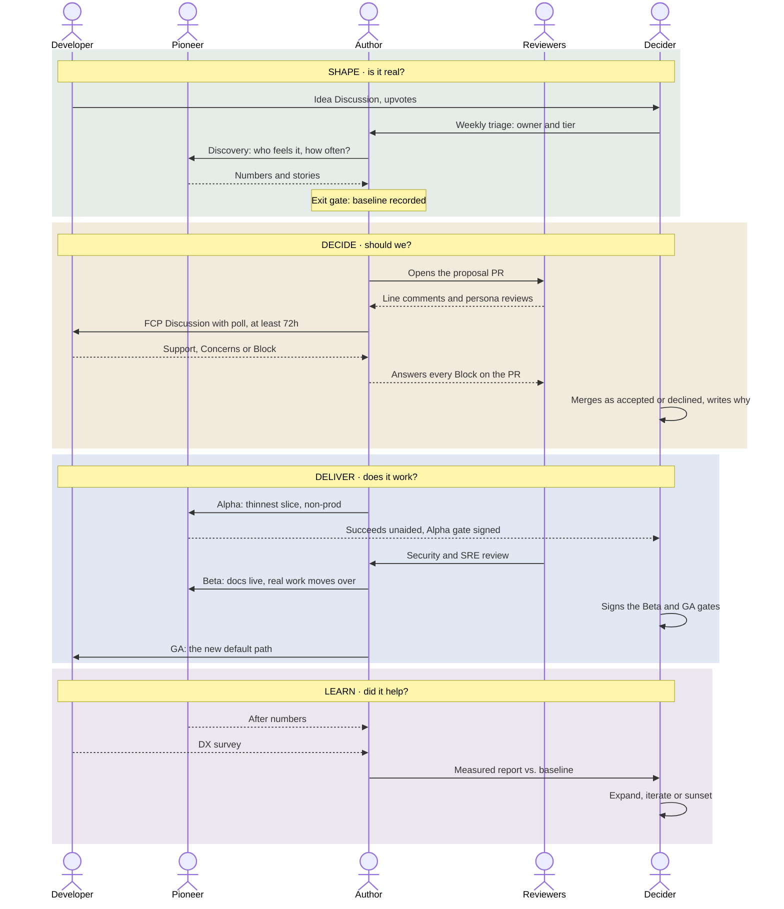

# The proposal flow

The process in [RFC-0000](../rfcs/0000-proposal-process.md), told from the point of view of the people in it.

**Interactive version:** [`docs/flow/index.html`](flow/index.html), published at <https://nondualworks.github.io/proposals/flow/> once GitHub Pages is on. It has a lane per person, a *See it as* filter, and a *Tools* switch between GitHub and Atlassian + Teams. Add `#atlassian` to the link to open it in the work profile.

## The five people

| In the flow | Role in [GOVERNANCE.md](../GOVERNANCE.md) | Their question |
|---|---|---|
| **Developer** | Anyone raising ideas and voting ([CONTRIBUTING.md](../CONTRIBUTING.md)) | *Can I ship without filing a ticket?* |
| **Pioneer** | Pioneer | *Does this solve my problem, for real?* |
| **Author** | Author | *What's the problem, and what does it cost today?* |
| **Reviewers** | Reviewer, including the five reviewer personas | *Where does this break at 3 a.m.?* |
| **Decider** | Decider. Here the maintainer also runs triage. | *Should we, and can I write down why?* |

## The flow

## Same process, different venues

This repo is the reference implementation. The rules don't change between tool stacks; only where each step happens does.

| Step | Job | GitHub (this repo) | Atlassian + Teams |
|---|---|---|---|
| Raise an idea, vote | track | Discussion in **Ideas**, upvotes | Jira issue labelled `rfc-idea`, Vote button |
| Rank top ideas | workshop | Discussion votes, monthly | Mural dot-vote workshop |
| Discovery brief | read | `discovery/` file via PR | Confluence page from a template |
| Proposal and line review | review | Pull request in this repo | Pull request in a Bitbucket `rfcs` repo |
| Comment-period poll | talk | Discussion poll ([HANDOFF](../HANDOFF.md) step 1) | Teams poll in the idea's thread |
| Phase board | track | GitHub Project, Phase field | Jira board with phase labels and JQL swimlanes |
| Decision | review | Merge with a *Decision* section | Same, in Bitbucket |
| Published read layer | read | README, MAP.md, this site | Confluence, generated by pandoc on merge |
| Small decisions | — | ADR in the product repo | ADR in the product repo |

Two rules matter more than the tools:

- **One venue per stage.** Before there's a PR, talk where ideas live. After, talk only on the PR.
- **The record lives with the proposal.** Poll tallies, decisions and answered questions are copied into the proposal file, because chat threads and polls are hard to find later.
