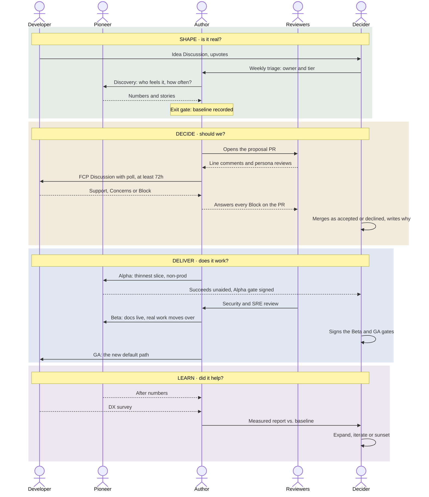

# The proposal flow

The process in [RFC-0000](../rfcs/0000-proposal-process.md), told from the point of view of the people in it.

**Interactive version:** [`docs/flow/index.html`](flow/index.html), published at <https://nondualworks.github.io/proposals/flow/> once GitHub Pages is on. It has a lane per person, a *See it as* filter, a *Tier* switch that fades what Lite Proposals and ADRs skip, and a *Tools* switch between GitHub and Atlassian + Teams. Add `#atlassian` to the link to open it in the work profile.

## The five people

| In the flow | Role in [GOVERNANCE.md](../GOVERNANCE.md) | Their question |
|---|---|---|
| **Developer** | Anyone raising ideas and voting ([CONTRIBUTING.md](../CONTRIBUTING.md)) | *Can I ship without filing a ticket?* |
| **Pioneer** | Pioneer | *Does this solve my problem, for real?* |
| **Author** | Author | *What's the problem, and what does it cost today?* |
| **Reviewers** | Reviewer, including the five reviewer personas | *Where does this break at 3 a.m.?* |
| **Decider** | Decider. Here the maintainer also runs triage. | *Should we, and can I write down why?* |

## The flow

## Lighter tiers

The diagram above is the **Full RFC** path. The other two tiers skip most of it.

| | Full RFC | Lite Proposal | ADR |
|---|---|---|---|
| **Use when** | New capability, golden-path change, a migration, or spans repos | Small, reversible, no migration, one page | Internal decision with no user-facing change, or one made inside an accepted RFC |
| **Lives in** | `rfcs/` here | `lite/` here | `docs/adr/` in the product repo |
| **Phases** | All nine | Idea → Draft → Comment period → Decision → GA → Measured | Draft → Decision |
| **People** | All five | No Pioneer | Author, Reviewers, Decider |
| **Comment period** | At least 72 hours | At least 48 hours | None; normal PR review |
| **Discovery Brief** | Required | Not needed | Not needed |
| **Alpha, Beta, GA gates** | Signed | None | None |
| **Measured** | Report against the baseline | One measure, noted on the proposal | — |

A Lite Proposal that grows past a page or needs a migration is promoted to a Full RFC. A Full RFC usually produces several ADRs as it's built.

### Which tier?

1. **Does it change what users see or do?** No → **ADR**.
2. **Does anyone have to migrate?** Yes → **Full RFC**.
3. **Does it fit on one page?** No → **Full RFC**. Yes → **Lite Proposal**.

## What each phase proves

The [CNCF Platform Engineering Maturity Model](https://tag-app-delivery.cncf.io/whitepapers/platform-eng-maturity-model/) has levels, not phases, and it doesn't prescribe artifacts. The two run on different clocks: phases describe one proposal over weeks, levels describe the team over quarters. So levels stay out of the flow and live in the heatmap in [MAP.md](../MAP.md).

What links them is evidence. Each phase leaves an artifact that proves something about one maturity aspect:

| Phase | Leaves behind | Evidence for | Why |
|---|---|---|---|
| Idea | Votes on ideas | **Adoption** | Teams asking for things is *intrinsic pull* (L3), not a mandate |
| Discovery | Baseline numbers | **Measurement** | Numbers exist before anything is built |
| Decision | Merged or declined proposal, with reasons | **Investment** | Work is funded on expected value, *as product* (L3) |
| Beta | Signed gate: security, docs | **Operations** | Ownership and support exist before rollout |
| GA | SLOs, support rota, a default path with docs | **Operations**, **Interfaces** | Self-service replaces tickets, and someone owns it |
| Measured | Before/after report | **Measurement**, **Adoption** | The only artifact that fills the heatmap |

Draft, comment period and Alpha matter, but they don't produce maturity evidence on their own.

The process is how the team produces its maturity evidence, so there's no separate assessment exercise. Asked "are we L2 or L3 on Adoption?", point at the vote counts and the Measured reports.

## Same process, different venues

This repo is the reference implementation. The rules don't change between tool stacks; only where each step happens does.

| Step | Job | GitHub (this repo) | Atlassian + Teams |
|---|---|---|---|
| Raise an idea, vote | track | Discussion in **Ideas**, upvotes | Jira issue labelled `proposal` + `prop-idea`, Vote button ([setup](platform-model/atlassian-setup.md#2-jira-proposals)) |
| Rank top ideas | workshop | Discussion votes, monthly | Mural dot-vote workshop |
| Discovery brief | read | `discovery/` file via PR | Confluence page from a template |
| Proposal and line review | review | Pull request in this repo | Pull request in a Bitbucket `rfcs` repo |
| Comment-period poll | talk | Discussion poll ([HANDOFF](../HANDOFF.md) step 1) | Teams poll in the idea's thread |
| Phase board | track | GitHub Project, Phase field | Jira board with `prop-` phase labels and JQL swimlanes |
| Decision | review | Merge with a *Decision* section | Same, in Bitbucket |
| Published read layer | read | README, MAP.md, this site | Confluence, generated by pandoc on merge |
| Small decisions | — | ADR in the product repo | ADR in the product repo |

Two rules matter more than the tools:

- **One venue per stage.** Before there's a PR, talk where ideas live. After, talk only on the PR.
- **The record lives with the proposal.** Poll tallies, decisions and answered questions are copied into the proposal file, because chat threads and polls are hard to find later.
